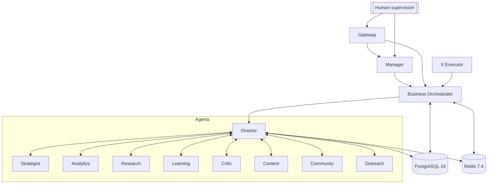

# Architecture

Arta AI Team is a containerized multi-agent system. All components run as Docker
containers on team-operated infrastructure. This document describes the logical
architecture only — no server addresses, credentials or deployment internals are included.

## Component Overview

| Layer | Component | Responsibility |
|---|---|---|
| Agents (9) | Director | Coordination, prioritization, execution flow |
| | Strategist | Strategic planning and scenario analysis |
| | Analytics | Data analysis and metrics |
| | Research | Information gathering and evaluation |
| | Learning | Training programs and knowledge building |
| | Critic | Quality review and risk detection |
| | Content | Content production |
| | Community | Community operations |
| | Outreach | External communications |
| Orchestration | Business Orchestrator | End-to-end workflow orchestration across agents |
| Operations | Manager | Operational coordination and supervision |
| Access | Gateway | Unified entry point for agent communication |
| Execution | X Executor | Task and job execution service |
| Persistence | PostgreSQL 16 | Durable storage |
| Caching / messaging | Redis 7.4 | Cache and message brokering |

At the November 2026 infrastructure inspection, all 15 containers were in running state
(infrastructure availability; functional evaluation of agent behavior is ongoing).

## Logical Diagram

## Design Principles

- **Specialization** — each agent has a single, well-defined role.
- **Coordination through the Director** — the Director agent orchestrates the team;
  infrastructure orchestration (Business Orchestrator) handles workflows.
- **Human supervision** — humans define goals, review outputs and retain decision authority.
- **State separation** — durable state in PostgreSQL; transient state and messaging in Redis.
- **No external exposure** — the system is not a public service; the Gateway mediates
  internal communication only.

## What Is Not Here

By design, this repository excludes: source code, container images, deployment manifests,
environment files, infrastructure addresses, monitoring internals and operational logs.
Access to those is restricted to the operating team.
